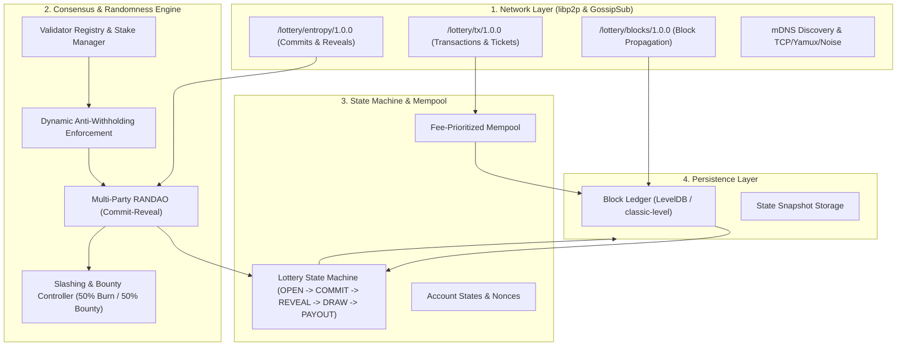
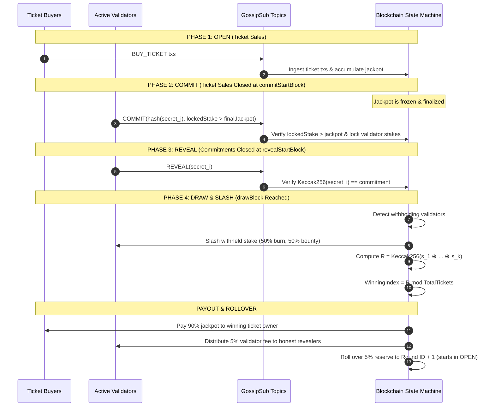

# Lottery Chain: Technical Architecture & Code Explanation

This document provides a comprehensive technical walkthrough of the **Lottery Chain** codebase, detailing the underlying cryptographic mechanisms, peer-to-peer networking, stake-backed RANDAO randomness engine, state machine, and ledger storage.

---

## 1. High-Level Architecture

The system is structured into four distinct modular layers:



---

## 2. Directory & Module Breakdown

| Path                           | Purpose                                   | Key Classes & Functions                                                                                              |
| :----------------------------- | :---------------------------------------- | :------------------------------------------------------------------------------------------------------------------- |
| `src/crypto/keys.ts`         | Cryptographic primitives & encoding       | `generateKeypair()`, `signMessage()`, `verifySignature()`, `aggregateSecretsXOR()`, `sha256Hex()`          |
| `src/types/index.ts`         | Core domain type definitions              | `Transaction`, `Block`, `EntropyCommitment`, `EntropyReveal`, `LotteryRound`, `RoundOutcome`             |
| `src/p2p/topics.ts`          | P2P pubsub topic identifiers              | `TOPIC_TX`, `TOPIC_ENTROPY`, `TOPIC_BLOCKS`                                                                    |
| `src/p2p/node.ts`            | libp2p node lifecycle & communication     | `P2PNetworkNode` (TCP, Noise, Yamux, GossipSub, mDNS)                                                              |
| `src/storage/ledger.ts`      | LevelDB persistence & in-memory cache     | `LedgerStorage` (`saveBlock`, `getBlock`, `saveState`, `getState`)                                         |
| `src/mempool/mempool.ts`     | Transaction validation & pool management  | `Mempool`, `createTransaction()`, `verifyTransaction()`                                                        |
| `src/consensus/randao.ts`    | Commit-reveal protocol & XOR entropy math | `createEntropyCommitment()`, `verifyEntropyReveal()`, `aggregateEntropy()`, `calculateWinningTicketIndex()`  |
| `src/consensus/validator.ts` | Validator registry & slashing economics   | `ValidatorManager` (`calculateRequiredStake()`, `slashWithholdingValidators()`, `distributeValidatorFees()`) |
| `src/consensus/lottery.ts`   | Lottery round lifecycle state machine     | `LotteryStateMachine` (`buyTickets()`, `recordCommitment()`, `recordReveal()`, `executeDrawAndPayout()`)   |
| `src/chain/chain.ts`         | Blockchain coordinator                    | `LotteryChain` (block proposal, state roots, block ingestion, P2P sync)                                            |
| `src/cli/index.ts`           | Command-line interface                    | Node runner, keygen, and state inspector                                                                             |
| `test/simulation.test.ts`    | Integration & scenario simulation         | 3-validator network lifecycle & malicious slashing test                                                              |

---

## 3. Cryptographic Primitives (`src/crypto/keys.ts`)

### 3.1 Ethereum-Standard Keys & Signatures

- **Elliptic Curve**: `secp256k1` via `@noble/curves/secp256k1.js` (identical to Ethereum mainnet).
- **Hash Function**: `Keccak-256` via `@noble/hashes/sha3.js` for transaction hashes, block headers, state roots, and commitments.
- **Address Format**: Standard **EIP-55 mixed-case checksummed Ethereum addresses** (`0x...` 40 hex characters) derived from uncompressed secp256k1 public keys.
- **Signatures**: 64-byte compact ECDSA signatures ($r \parallel s$) over `keccak256(message)` validated via `secp256k1.verify`.

### 3.2 Multi-Party XOR Entropy Aggregation

Each participating validator $i$ generates a random 32-byte secret $s_i \in \{0, 1\}^{256}$. The accumulated secret is derived via sequential bitwise XOR:

$$
S = s_1 \oplus s_2 \oplus \dots \oplus s_k
$$

**Why XOR?**

1. **Uniformity Preserving**: If even **one** participant is honest and samples their secret from a uniform distribution, the resulting XOR sum $S$ is uniformly distributed, regardless of the choices or distributions of all other $k-1$ participants.
2. **Associative & Commutative**: The ordering of reveals does not impact the aggregate result.
3. **Collision Resistance via Final Hashing**: The final randomness seed $R$ is calculated using Keccak-256:

   $$
   R = \text{Keccak256}(S)
   $$

   This ensures unpredictable bit dispersion across the entire 256-bit scalar field.

---

## 4. Multi-Party Commit-Reveal (RANDAO) Protocol (`src/consensus/randao.ts`)

The randomness protocol runs in four synchronized phases per lottery round:



### 4.1 Phase 1: OPEN (Ticket Sales)

- Ticket buyers purchase tickets via `BUY_TICKET` transactions.
- Commitments from validators are rejected during this phase (`Commitments only accepted in COMMIT phase`).

### 4.2 Phase 2: COMMIT (Jackpot Frozen & Stake Locking)

When `commitStartBlock` is reached, ticket sales close and the jackpot is frozen:

- Any subsequent `BUY_TICKET` transaction is rejected, guaranteeing that the jackpot cannot increase further.
- Validators calculate the required stake against the final, immutable jackpot:
  $$
  \text{Required Stake } (D) > \text{Final Jackpot}
  $$
- Validators broadcast an `EntropyCommitment` object:

```json
{
  "roundId": 1,
  "validator": "0x...",
  "commitment": "keccak256(secret_i)",
  "lockedStake": 100,
  "timestamp": 1700000000000,
  "publicKey": "...",
  "signature": "..."
}
```

Validation rules:

- $\text{verifySignature}(\text{signature}, \text{canonicalJSON}, \text{publicKey}) = \text{true}$.
- Validator must be an active, un-slashed validator.
- The commitment matches the active round ID and occurs within the `COMMIT` phase (before `revealStartBlock`).
- `lockedStake >= calculateRequiredStake(finalJackpot)`.

### 4.3 Phase 3: REVEAL (Preimage Revelation)

When `revealStartBlock` is reached, commitment submissions close and validators reveal their secrets:

```json
{
  "roundId": 1,
  "validator": "0x...",
  "secret": "64_hex_chars_32_bytes",
  "timestamp": 1700000001000,
  "publicKey": "...",
  "signature": "..."
}
```

Validation rules:

- Preimage check: $\text{toHex}(\text{Keccak256}(\text{fromHex}(\text{secret}))) == \text{commitment}$.
- Round ID and validator address match the committed state.

---

## 5. Economic Security & Slashing Model (`src/consensus/validator.ts`)

### 5.1 The Anti-Withholding Rule

In classic commit-reveal lotteries, a malicious validator who purchases tickets could simulate the draw result upon seeing other reveals. If they compute that revealing causes their ticket to lose, they might attempt to **withhold** their secret, forcing a fallback or abort.

To prevent this attack, `ValidatorManager.calculateRequiredStake` dynamically enforces:

$$
\text{Required Stake } (D) > \text{Current Round Jackpot}
$$

$$
\text{Required Stake } (D) = \max(\text{MIN\_VALIDATOR\_STAKE}, \text{Jackpot} + 10)
$$

Because the slashed stake $D$ strictly exceeds the maximum possible winnings ($\text{Jackpot}$), withholding guarantees a net financial loss under all circumstances:

$$
\mathbb{E}[\text{Profit from withholding}] \le \text{Jackpot} - D < 0
$$

### 5.2 Slashing Distribution

When a validator commits in Phase 1 but fails to submit a valid reveal before the round draw block:

1. **50% Burn**: Slashed stake is destroyed permanently from the supply (`chainState.totalBurned += burnedAmount`), punishing the attacker.
2. **50% Slashing Bounty**: The remaining 50% is divided equally among honest revealers as a bounty for maintaining chain liveness.
3. **Deactivation**: Slashed validators are marked `slashed: true` and cannot participate until rehabilitated.

### 5.3 Round Prize Distribution

When tickets are purchased, ticket revenue accumulates into the round's `jackpot`:

- **90% Winner Payout**: Credited directly to the winning ticket buyer's account balance.
- **5% Validator Fee Pool**: Shared equally among all honest revealers who submitted valid entropy.
- **5% Rollover Reserve**: Carried forward to seed the jackpot of Round $N+1$.
- _(Edge Case: If 0 tickets are sold, 100% of the jackpot rolls over)._

---

## 6. P2P Networking & GossipSub (`src/p2p/node.ts`, `src/p2p/topics.ts`)

Built using `js-libp2p` v3 with:

- **Transports**: `@libp2p/tcp` for node-to-node communication.
- **Security**: `@chainsafe/libp2p-noise` (`Noise_XX_25519_ChaChaPoly_SHA256`).
- **Multiplexing**: `@libp2p/yamux` multiplexing streams over single TCP sockets.
- **Peer Discovery**: `@libp2p/mdns` local multi-cast DNS discovery.
- **PubSub**: `@chainsafe/libp2p-gossipsub` with three dedicated channels:
  - `/lottery/tx/1.0.0`: Broadcasts `BUY_TICKET`, `TRANSFER`, `STAKE`, and `UNSTAKE` transactions.
  - `/lottery/entropy/1.0.0`: Broadcasts `COMMIT` and `REVEAL` packets.
  - `/lottery/blocks/1.0.0`: Propagates newly mined blocks and round outcome summaries.

---

## 7. Ledger & State Coordinator (`src/chain/chain.ts`, `src/storage/ledger.ts`)

### 7.1 Block Structure

Every block bundles:

- `header`:
  - `index`: Monotonically increasing height.
  - `previousHash`: Keccak-256 hash of the parent block header.
  - `stateRoot`: Keccak-256 hash of the complete account and round state snapshot.
  - `txRoot`: Keccak-256 digest of included transaction hashes.
  - `entropyRoot`: Keccak-256 digest of included commitments and reveals.
  - `proposer`: Address of the validator proposing the block (EIP-55 Ethereum address).
  - `roundId`: Active lottery round identifier.
- `transactions`: Validated transactions drained from the mempool.
- `commitments` & `reveals`: Validator entropy gossip ingested.
- `roundOutcome`: Optional metadata attached when a round transitions to `DRAW`.

### 7.2

`LedgerStorage` manages LevelDB (`classic-level`) key-value storage:

- `block:<index>` $\rightarrow$ Full block JSON object.
- `hash:<hash>` $\rightarrow$ Block index pointer.
- `meta:latestBlockIndex` $\rightarrow$ Current chain tip.
- `state:latest` $\rightarrow$ Serialized accounts, validator stakes, and round history.

---

## 8. Simulation Test Walkthrough (`test/simulation.test.ts`)

The automated integration test (`npm test`) verifies end-to-end functionality:

```
====================================================
  LOTTERY BLOCKCHAIN 3-VALIDATOR SIMULATION TEST
====================================================

[Step 1] Initializing validator identities and buyer accounts...
Validator 1: 0xbD846B09f6A97f5AD861A93Be1148a8a5297F520 (Stake: 500)
Validator 2: 0xF3105210300734Dd2A9cc75d16E6ddFcB5482DCd (Stake: 500)
Validator 3: 0xB62EB035FF2DF98c9AE91686CF86E43F571A70b5 (Stake: 500)
Buyer A:     0x9f70f16C8e36df3ba908b67B70EcfBaAEB3152e8 (Balance: 500)
Buyer B:     0xbA06007d978013a9d14f9ca2A3DDaFf666B8D3a2 (Balance: 500)

[Step 2] Chain genesis initialized successfully.
```

### Scenario 1: Honest Round Lifecycle

1. **Ticket Sales**: Buyer A purchases 3 tickets (30 coins); Buyer B purchases 2 tickets (20 coins). Total Jackpot = 50 coins.
2. **Commitments**: Validators 1, 2, and 3 broadcast commitments. Anti-withholding requirement verified: $D = 100 > 50$.
3. **Phase Advancement**: Blocks are mined until `revealStartBlock` is reached. Round enters `REVEAL`.
4. **Reveals**: All 3 validators broadcast valid secrets.
5. **Draw & Payout**:
   - $S = s_1 \oplus s_2 \oplus s_3$, $R = \text{SHA256}(S)$.
   - $\text{WinningIndex} = R \pmod 5 = 4$ (Buyer B's ticket).
   - Winner payout: 45 coins (90%).
   - Validator fee: 2 coins (5% split).
   - Rollover reserve: 3 coins (5%) moved to Round 2.

### Scenario 2: Withholding Attack & Slashing

1. **Round 2 Setup**: Starts with 3 coins rollover + 5 new tickets from Buyer A (50 coins). Total Jackpot = 53 coins.
2. **Commitments**: All 3 validators commit 100 stake.
3. **Withholding**: Validators 1 & 2 reveal their secrets. Validator 3 **withholds**.
4. **Draw & Slash Execution**:
   - Validator 3 detected as non-revealing.
   - Slashed stake: 100 coins.
   - Burned (50%): 50 coins permanently removed from supply.
   - Bounty (50%): 50 coins distributed to Validators 1 & 2 (+25 coins each).
   - Randomness aggregated solely from honest reveals ($s_1 \oplus s_2$).
   - Winner paid 90%, and Round 3 initialized.

---

## 9. Commands & Scripts

```bash
# Compile TypeScript to dist/
npm run build

# Run the 3-validator simulation test suite
npm test

# Generate a new Ed25519 identity keypair
npm start keygen

# Start a P2P node
npm start node -- --port 9001 --db ./data-node-9001

# Inspect local node and round status
npm start status -- --db ./data-node-9001
```
